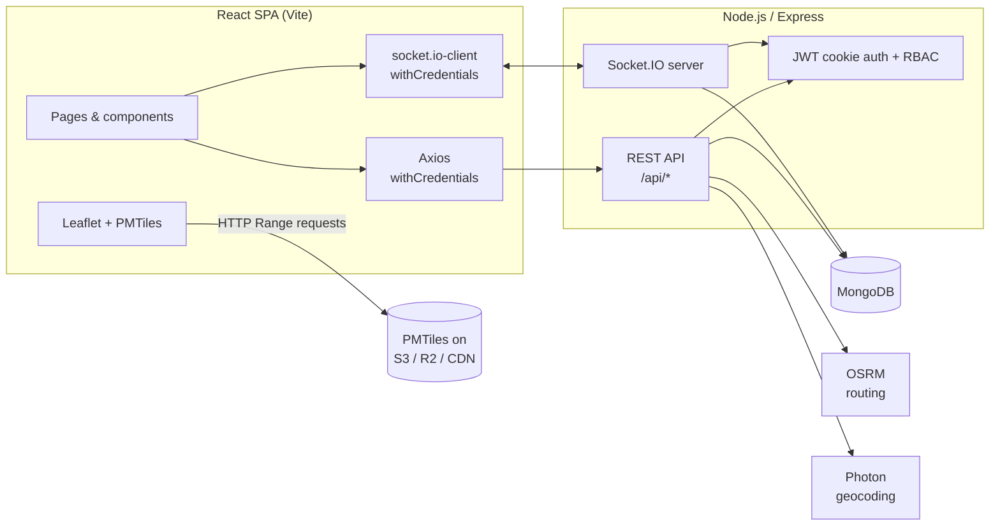
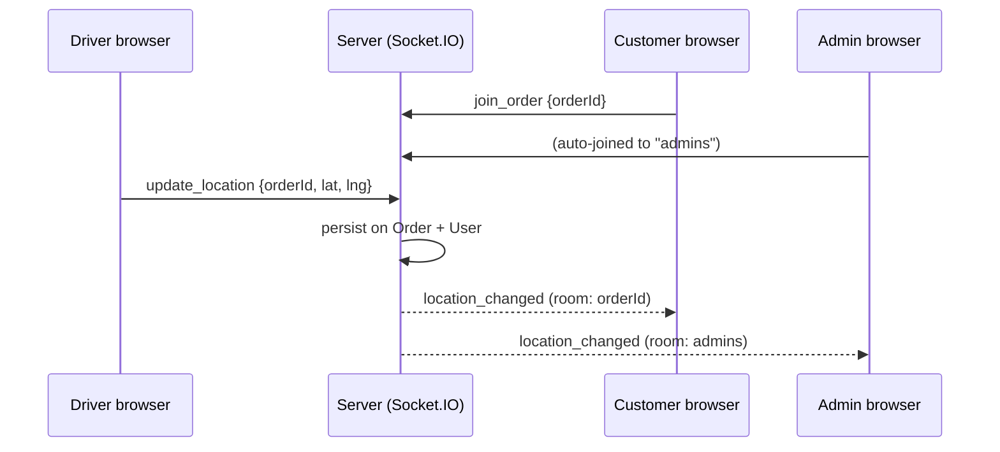
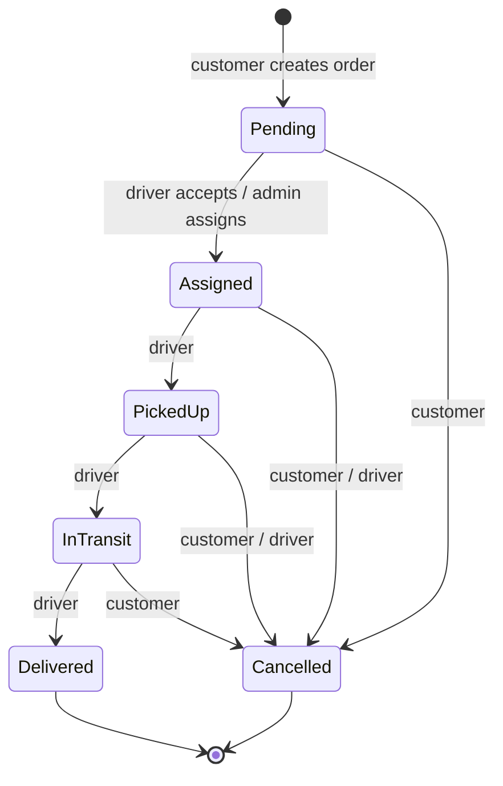

<div align="center">


# DeliverEase

**Delivery & Logistics Management System with real-time GPS tracking**


English / العربية (RTL) · Self-hosted maps · Real-time tracking · Role-based access

</div>

---

## Table of contents

1. [Overview](#1-overview)
2. [Features](#2-features)
3. [Tech stack](#3-tech-stack)
4. [Architecture](#4-architecture)
5. [Project structure](#5-project-structure)
6. [Getting started](#6-getting-started)
7. [Configuration](#7-configuration)
8. [Data models](#8-data-models)
9. [Order lifecycle & pricing](#9-order-lifecycle--pricing)
10. [REST API reference](#10-rest-api-reference)
11. [Real-time (Socket.IO)](#11-real-time-socketio)
12. [Maps, routing & geocoding](#12-maps-routing--geocoding)
13. [Internationalization (English / Arabic)](#13-internationalization-english--arabic)
14. [UI, theming & branding](#14-ui-theming--branding)
15. [Security](#15-security)
16. [Deployment](#16-deployment)
17. [Troubleshooting](#17-troubleshooting)
18. [Known limitations & roadmap](#18-known-limitations--roadmap)
19. [Credits & licensing](#19-credits--licensing)

---

## 1. Overview

DeliverEase connects **customers** who need parcels delivered with **drivers** who carry them, under the control of
an **admin** who monitors the whole operation. Customers place orders and watch the driver move on a live map;
drivers accept jobs, update delivery status and broadcast their GPS position; admins see KPIs, manage drivers,
assign orders and follow every active delivery on one map.

Design goals:

- **Real time first.** Location and status changes are pushed over WebSockets; no polling.
- **Secure by default.** JWT in HTTP-only cookies, role-based access control, ownership checks on every order.
- **Low running cost.** Free/open map stack: OpenStreetMap data, Photon geocoding, OSRM routing and a
  self-hosted PMTiles basemap on static storage (S3 / R2 / CDN).
- **Bilingual.** Full English and Arabic UI with automatic right-to-left layout.

---

## 2. Features

### Customer
| Feature | Details |
|---|---|
| Create order | Pickup and delivery addresses via autocomplete, parcel weight / dimensions / instructions, delivery priority (`standard`, `express`, `urgent`) |
| Instant price | Calculated server-side from priority, weight and real driving distance |
| Delivery history | All orders with status badges: `Pending`, `Assigned`, `Picked Up`, `In Transit`, `Delivered`, `Cancelled` |
| Live tracking | Map zooms to show pickup, delivery and route; driver marker moves in real time; driver contact is tap-to-call |
| Cancel order | Allowed until the order is delivered |

### Driver
| Feature | Details |
|---|---|
| Job board | Real-time offers for unassigned orders and own active jobs |
| Accept / reject | First driver to accept gets the order; admins are notified of rejections |
| Status updates | `Assigned → Picked Up → In Transit → Delivered` (enforced transitions) |
| GPS broadcaster | Browser geolocation is emitted over Socket.IO while on an active delivery |
| Availability | Online / offline toggle; automatically marked offline on disconnect |

### Admin
| Feature | Details |
|---|---|
| Dashboard | Total orders, active deliveries, online drivers, revenue (delivered orders) |
| Driver management | See all drivers, online state, completed deliveries |
| Assignment | Manually assign or reassign any order to an online driver |
| Global live map | All active deliveries and driver positions in one view |
| Activity feed | Live notifications: new orders, status changes, driver presence, rejections |

### Platform
- English / Arabic with RTL, preference remembered per browser
- Responsive layouts (mobile → desktop), sticky navbar with role-aware navigation and account menu
- Self-hosted vector basemap with automatic fallback to OpenStreetMap tiles
- Seed script to create (or promote) the first admin

---

## 3. Tech stack

| Layer | Technology |
|---|---|
| Frontend | React 18, React Router 6, Vite 5, Tailwind CSS 3, react-icons, Axios |
| Maps (client) | Leaflet + react-leaflet 4, `protomaps-leaflet` (vector PMTiles), OSM raster fallback |
| Real time | Socket.IO 4 (server and client) |
| Backend | Node.js 18+, Express 4, Mongoose 8 |
| Database | MongoDB (local or Atlas) |
| Auth | JSON Web Tokens in HTTP-only cookies, bcrypt password hashing, RBAC middleware |
| Security middleware | helmet, cors (single trusted origin), cookie-parser, morgan logging |
| Geocoding | [Photon](https://photon.komoot.io) (OpenStreetMap), proxied and cached by the backend |
| Routing | [OSRM](https://project-osrm.org) driving directions |
| Tiles | [Protomaps](https://protomaps.com) PMTiles hosted on S3 / Cloudflare R2 / CDN |

---

## 4. Architecture



**Request flow.** The browser calls REST endpoints with the auth cookie. Controllers read/write MongoDB and,
after state changes, emit Socket.IO events through the shared `io` instance (`req.app.get('io')`).

**Live-tracking flow.**



---

## 5. Project structure

```
deliverease/
├─ package.json                 Root scripts (dev, build, start, seed:admin)
├─ .env.example                 Combined reference of all environment variables
├─ README.md
├─ docs/
│  └─ self-hosted-tiles.md      PMTiles creation + S3/R2/CloudFront setup
├─ brand-assets/                Logos (SVG/PNG) and brand guidelines
├─ backend/
│  ├─ server.js                 Express + Socket.IO bootstrap
│  ├─ config/db.js              MongoDB connection
│  ├─ models/                   User, Order, DriverProfile
│  ├─ middleware/               auth (protect/authorize), errorHandler
│  ├─ controllers/              auth, order, driver, admin, geocode
│  ├─ routes/                   auth, orders, driver, admin, geocode
│  ├─ sockets/socketHandler.js  Socket auth, rooms, live location relay
│  ├─ utils/osrm.js             OSRM route lookup with straight-line fallback
│  └─ seeds/seedAdmin.js        Create / promote / reset an admin
└─ frontend/
   ├─ index.html, vite.config.js, tailwind.config.js
   ├─ public/favicon.svg
   └─ src/
      ├─ main.jsx, App.jsx      Providers + routing
      ├─ api/axios.js           Axios instance (cookies)
      ├─ context/               AuthContext, SocketContext, I18nContext
      ├─ i18n/translations.js   English and Arabic strings
      ├─ components/            Navbar, Logo, LanguageSwitcher, LiveMap,
      │                         AddressAutocomplete, ProtectedRoute
      └─ pages/
         ├─ Login.jsx, Register.jsx
         ├─ customer/           CreateOrder, OrderHistory, TrackOrder
         ├─ driver/             DriverDashboard, ActiveDelivery
         └─ admin/              AdminDashboard, DriverManagement, GlobalMap
```

---

## 6. Getting started

### Prerequisites

- Node.js **18+** and npm
- A MongoDB database (local `mongod` or a free MongoDB Atlas cluster)

### Install

```bash
npm run install:all        # installs root, backend and frontend dependencies
```

### Configure

```bash
cp backend/.env.example  backend/.env
cp frontend/.env.example frontend/.env
```

Edit the two files (see [Configuration](#7-configuration)). At minimum set `MONGO_URI` and a strong `JWT_SECRET`.

### Create the first admin

Admins cannot self-register. After `MONGO_URI` is set (optionally `ADMIN_NAME`, `ADMIN_EMAIL`, `ADMIN_PASSWORD`
in `backend/.env`):

```bash
npm run seed:admin
npm run seed:admin -- --email=boss@example.com --name="Boss"        # flags override env vars
npm run seed:admin -- --email=someone@example.com --promote          # promote an existing user
npm run seed:admin -- --email=boss@example.com --reset-password      # set a new password
```

The script is idempotent. With no password provided it generates a random one and prints it **once**.

### Run

```bash
npm run dev                # API on :5000 and web app on :5173, side by side
```

| Script | Purpose |
|---|---|
| `npm run dev` | Backend (nodemon) + frontend (Vite) together |
| `npm run dev:backend` / `dev:frontend` | Run one side only |
| `npm run build` | Production build of the frontend (`frontend/dist`) |
| `npm start` | Start the backend with Node (production) |
| `npm run seed:admin` | Create / promote / reset an admin account |

Open <http://localhost:5173>, register a **customer** and a **driver** (use two browsers or a private window),
log in as the admin you seeded, and try the full flow.

---

## 7. Configuration

### Backend (`backend/.env`)

| Variable | Default / example | Description |
|---|---|---|
| `NODE_ENV` | `development` | `production` enables `secure` + `sameSite=none` cookies and hides stack traces |
| `PORT` | `5000` | HTTP port (Render injects its own) |
| `MONGO_URI` | `mongodb://127.0.0.1:27017/delivery_logistics` | MongoDB connection string (include the database name) |
| `JWT_SECRET` | *(required)* | Long random secret, e.g. `openssl rand -hex 32` |
| `JWT_EXPIRES_IN` | `7d` | Token lifetime |
| `COOKIE_NAME` | `dls_token` | Auth cookie name |
| `CLIENT_URL` | `http://localhost:5173` | Exact frontend origin, **no trailing slash** (CORS + Socket.IO) |
| `OSRM_BASE_URL` | `https://router.project-osrm.org` | Routing server (demo server is dev-only) |
| `GEOCODER_URL` | `https://photon.komoot.io` | Geocoding server (public instance is fair-use) |
| `ADMIN_NAME`, `ADMIN_EMAIL`, `ADMIN_PASSWORD` | — | Used only by `npm run seed:admin` |

### Frontend (`frontend/.env`)

Vite inlines these at **build time**; restart `npm run dev` / rebuild after changing them.

| Variable | Example | Description |
|---|---|---|
| `VITE_API_URL` | `http://localhost:5000/api` | REST base URL |
| `VITE_SOCKET_URL` | `http://localhost:5000` | Socket.IO server URL (no `/api`) |
| `VITE_PMTILES_URL` | `https://cdn.example.com/tiles/sudan.pmtiles` | Self-hosted basemap. Leave empty to use public OSM tiles |
| `VITE_MAP_FLAVOR` | `light` | `light`, `dark`, `white`, `grayscale` or `black` |

> Never commit real `.env` files. They are listed in `.gitignore`; only the `*.example` files are tracked.

---

## 8. Data models

### User
| Field | Type | Notes |
|---|---|---|
| `name`, `email` (unique), `password` | String | Password hashed with bcrypt, never returned by default |
| `phone` | String | Optional |
| `role` | `customer` \| `driver` \| `admin` | Default `customer` |
| `isActive` | Boolean | Deactivated users cannot authenticate |
| `isOnline` | Boolean | Drivers: availability / presence |
| `currentLocation` | `{ lat, lng, updatedAt }` | Last known GPS position |

### DriverProfile
| Field | Type | Notes |
|---|---|---|
| `user` | ObjectId → User | Unique |
| `vehicleType` | `bike` \| `car` \| `van` \| `truck` | Default `bike` |
| `vehiclePlate`, `licenseNumber` | String | Optional |
| `rating` | Number 0–5 | Default 5 |
| `completedDeliveries` | Number | Incremented on delivery |
| `status` | `offline` \| `available` \| `busy` | Kept in sync with jobs and presence |
| `activeOrder` | ObjectId → Order | Current job |

### Order
| Field | Type | Notes |
|---|---|---|
| `customer`, `driver` | ObjectId → User | `driver` is null until assigned |
| `pickupAddress`, `deliveryAddress` | `{ label, line1, city, lat, lng }` | Coordinates required |
| `parcel` | `{ weightKg, dimensions{lengthCm,widthCm,heightCm}, instructions }` | `weightKg` required |
| `priority` | `standard` \| `express` \| `urgent` | |
| `status` | `Pending` \| `Assigned` \| `Picked Up` \| `In Transit` \| `Delivered` \| `Cancelled` | |
| `statusHistory` | `[{ status, changedAt, note }]` | Appended automatically on every change |
| `currentLocation` | `{ lat, lng, updatedAt }` | Latest driver position (for reconnecting clients) |
| `route` | `{ waypoints[[lat,lng]], distanceMeters, durationSeconds, source }` | `source`: `osrm` or `straight_line` |
| `price`, `isPaid`, `cancelReason` | | |

Indexes: `{ customer, createdAt }` and `{ driver, status }`.

---

## 9. Order lifecycle & pricing



*(`PickedUp` is shown as `Picked Up`, `InTransit` as `In Transit` in the app.)*

Driver-side transitions are validated server-side:

| From | Allowed next |
|---|---|
| `Assigned` | `Picked Up`, `Cancelled` |
| `Picked Up` | `In Transit`, `Cancelled` |
| `In Transit` | `Delivered` |

Side effects: accepting or being assigned marks the driver `busy`; delivery or a customer cancellation frees the driver,
and delivery also increments `completedDeliveries`.

**Pricing** (`orderController.js`):

```
price = priorityBase + (weightKg × 0.8) + (distanceKm × 0.6)
priorityBase: standard = 5, express = 9, urgent = 15
```

Distance comes from OSRM; if routing is unavailable the distance term is omitted and a straight-line route is used.

---

## 10. REST API reference

Base URL: `/api` · Format: JSON · Auth: HTTP-only cookie (`Authorization: Bearer <jwt>` also accepted for tools).

Success responses are `{ "success": true, ... }`. Errors are `{ "success": false, "message": "..." }`
(plus `stack` outside production).

### Health
| Method | Path | Auth | Description |
|---|---|---|---|
| GET | `/health` | none | Liveness check |

### Auth: `/api/auth`
| Method | Path | Auth | Body / notes |
|---|---|---|---|
| POST | `/register` | none | `{ name, email, password, phone?, role? }`: `role` is `customer` or `driver` only; sets the auth cookie |
| POST | `/login` | none | `{ email, password }`: sets the auth cookie |
| POST | `/logout` | any | Clears the cookie |
| GET | `/me` | any | Current user |

### Orders: `/api/orders` (customer)
| Method | Path | Role | Description |
|---|---|---|---|
| POST | `/` | customer | Create order. Computes route (OSRM) and price, notifies admins (`new_order`) |
| GET | `/my` | customer | The caller's orders, newest first |
| GET | `/:id` | owner, assigned driver, admin | Order details with populated customer/driver |
| PATCH | `/:id/cancel` | customer (owner) | `{ reason? }`: not allowed once delivered or already cancelled |

<details>
<summary>Example: create an order</summary>

```bash
curl -X POST http://localhost:5000/api/orders \
  -H "Content-Type: application/json" -b cookies.txt \
  -d '{
    "pickupAddress":   { "line1": "Street 1", "city": "Khartoum", "lat": 15.5007, "lng": 32.5599 },
    "deliveryAddress": { "line1": "Street 9", "city": "Omdurman", "lat": 15.6445, "lng": 32.4777 },
    "parcel": { "weightKg": 2.5, "instructions": "Fragile" },
    "priority": "express"
  }'
```
</details>

### Driver: `/api/driver` (driver)
| Method | Path | Description |
|---|---|---|
| GET | `/jobs` | Pending unassigned orders plus the driver's active jobs |
| PATCH | `/jobs/:id/accept` | Claim a pending order (fails if already taken or driver is busy) |
| PATCH | `/jobs/:id/reject` | Notify admins of the rejection |
| PATCH | `/jobs/:id/status` | `{ status }`: validated transition (see [lifecycle](#9-order-lifecycle--pricing)) |
| PATCH | `/online-status` | `{ isOnline }`: toggle availability |

### Admin: `/api/admin` (admin)
| Method | Path | Description |
|---|---|---|
| GET | `/metrics` | `{ totalOrders, activeDeliveries, onlineDrivers, revenue, statusBreakdown }` |
| GET | `/orders` | All orders. Query: `status=<status>`, `unassigned=true` |
| GET | `/drivers` | All drivers with their profile |
| PATCH | `/orders/:id/assign` | `{ driverId }`: assign or reassign; frees the previous driver; pushes `job_offer` to the driver |

### Geocoding: `/api/geocode`
| Method | Path | Auth | Description |
|---|---|---|---|
| GET | `/search?q=<text>&lang=en` | any logged-in user | Address autocomplete. `q` ≥ 3 chars; `lang` ∈ `en,de,fr,it`. Returns `{ results: [{ id, label, line1, city, lat, lng }] }`. Cached 10 min |

### Status codes
`200/201` success · `400` validation or business rule · `401` not authenticated · `403` wrong role / not your order ·
`404` not found · `502` upstream (geocoder) unavailable.

---

## 11. Real-time (Socket.IO)

**Authentication.** The socket handshake reuses the same HTTP-only JWT cookie as the REST API (the client connects
with `withCredentials: true`); unauthenticated sockets are rejected.

**Rooms**

| Room | Who joins | Purpose |
|---|---|---|
| `<orderId>` | Customer (owner), assigned driver, admin, via `join_order` | Tracking one order |
| `admins` | All admins (automatic) | Global map and activity feed |
| `driver_<userId>` | Each driver (automatic) | Direct job offers |

**Client → server**

| Event | Payload | Notes |
|---|---|---|
| `join_order` | `{ orderId }` | Authorization checked (owner / assigned driver / admin) |
| `leave_order` | `{ orderId }` | |
| `update_location` | `{ orderId, lat, lng }` | Drivers only. Persisted to Order and User |

**Server → client**

| Event | Room | Payload |
|---|---|---|
| `joined_order` | caller | `{ orderId, currentLocation, status }` |
| `location_changed` | `<orderId>` and `admins` | `{ orderId, driverId, lat, lng, updatedAt }` |
| `status_change` | `<orderId>` | `{ orderId, status, driver? }` |
| `new_order` | `admins` | Full order |
| `order_updated` | `admins` | Full order |
| `job_offer` | `driver_<id>` | Full order (admin assignment) |
| `job_rejected` | `admins` | `{ orderId, driverId }` |
| `driver_presence` | `admins` | `{ driverId, isOnline }` |
| `error_message` | caller | `{ message }` |

A driver is marked **offline** automatically when their last socket disconnects.

---

## 12. Maps, routing & geocoding

All three map services are free/open and replaceable through environment variables.

### Basemap: self-hosted PMTiles
`LiveMap.jsx` renders a vector basemap from a single `.pmtiles` file on static storage using `protomaps-leaflet`.

1. Cut your region from the Protomaps world build with the `pmtiles` CLI.
2. Upload to S3 / Cloudflare R2 and configure **CORS** (allow `Range` and `If-Match`, expose `ETag`).
3. Set `VITE_PMTILES_URL` and rebuild the frontend.

Full walkthrough: **[docs/self-hosted-tiles.md](docs/self-hosted-tiles.md)**.

`LiveMap` is defensive. On load it verifies the file (HTTP Range support, PMTiles header, CORS pre-flight with
`If-Match`) and **falls back to OpenStreetMap raster tiles** if the file can't be read or draws only blank tiles.
Add `?mapdebug` to any page URL to overlay a status panel (size, zoom, markers in view, tile counts, errors).

### Map behavior
- Auto-fits the view to show pickup, delivery, route and driver on load and on resize (until the user pans/zooms).
- Follows the driver only when the driver leaves the visible area.
- Themed pins: pickup (teal), delivery (rose), driver (badge with car icon).

### Routing: OSRM
`backend/utils/osrm.js` requests a real driving route at order creation and stores waypoints, distance and
duration on the order. If OSRM is unreachable the order is still created with a straight-line route
(`route.source = "straight_line"`).

### Geocoding: Photon
The browser never talks to Photon directly. `GET /api/geocode/search` proxies and caches requests, which keeps the
upstream URL configurable and protects it from abuse. Selecting a suggestion supplies `line1`, `city`, `lat`, `lng`;
editing the text afterwards clears the coordinates so a stale location cannot be submitted.

> The public Photon, OSRM and OSM tile servers are fair-use. For production traffic, self-host them (or use a
> provider) and point `GEOCODER_URL`, `OSRM_BASE_URL` and `VITE_PMTILES_URL` at your own instances.

---

## 13. Internationalization (English / Arabic)

- `src/i18n/translations.js` holds flat `en` / `ar` maps with `{placeholder}` interpolation.
- `I18nContext` exposes `useI18n()` → `t()`, `lang`, `setLang()`, `statusLabel()`, `formatDate()`, `money()`
  and a direction-aware `arrow`. It sets `<html lang dir>`, so layouts mirror automatically for RTL.
- The choice is stored in `localStorage` (`dls_lang`); the default follows the browser language.
- Order statuses and priorities are stored in English in the database and translated only for display.
- Map labels follow the app language where the basemap data provides Arabic names.
- Add a language: add a block to `translations.js` and a locale entry in `I18nContext.jsx`.
- Not yet translated: error messages returned by the API.

---

## 14. UI, theming & branding

### Palette (design tokens)

| Token | Value | Use |
|---|---|---|
| `primary` | `#0D9488` | Actions, links, badges |
| `primary-dark` | `#115E59` | Hover, delivered status, small text |
| `accent` | `#FB7185` | Highlights, "in transit", delivery pin |
| `on-primary` | `#FFFFFF` | Text on primary |
| `on-accent` | `#3B0713` | Text on accent |
| `bg` (`canvas`) | `#F1FAF9` | Page background |
| `surface` | `#FFFFFF` | Cards, navbar |
| `text` (`ink`) | `#0F2B29` | Body text |
| `muted` | `#5E7C79` | Secondary text |
| `border` (`line`) | `rgba(15,43,41,.09)` | Dividers and outlines |

Defined in `frontend/tailwind.config.js` (named tokens plus remapped `brand-*` and `gray-*` scales) and mirrored as
CSS variables in `frontend/src/index.css`.

### Logo & assets
`brand-assets/` contains the icon, horizontal, stacked, reversed and Arabic lockups (SVG), PNG exports and the
brand guidelines page. Primary on white is best kept for buttons and large type; use `primary-dark` for small text.

### Responsiveness
Mobile-first layouts: compact navbar with avatar menu on phones, inline role navigation on desktop, map heights
that adapt (`45vh` on phones, `70vh` on desktop).

---

## 15. Security

| Area | Implementation |
|---|---|
| Authentication | JWT in an **HTTP-only** cookie (`secure` + `sameSite=none` in production, `lax` in development) |
| Authorization | `protect` + `authorize(...roles)` middleware; order ownership checks in controllers and on socket room joins |
| Passwords | bcrypt (10 salt rounds), `select: false` on the field |
| Privilege escalation | Self-registration can only create `customer` or `driver`; admins come from the seed script |
| Transport headers | `helmet` defaults |
| CORS | Single trusted origin (`CLIENT_URL`) with credentials |
| Sockets | Cookie-authenticated handshake; per-event authorization |
| Errors | Stack traces hidden when `NODE_ENV=production` |

**Recommended before going live:** add rate limiting on `/api/auth/*`, request-body validation (e.g.
`express-validator`, already a dependency), refresh-token rotation, CSRF protection if you rely on
`sameSite=none` cookies across sites, and audit logging for admin actions.

---

## 16. Deployment

### Database: MongoDB Atlas
Create a cluster and a database user, then allow your host's IPs under **Network Access** (`0.0.0.0/0` for hosts
with dynamic IPs). Use the `mongodb+srv://…` string, including the database name, as `MONGO_URI`.

### Backend on Render

| Setting | Value |
|---|---|
| Service type | Web Service |
| Root directory | `backend` |
| Build command | `npm install` |
| Start command | `npm start` |
| Health check path | `/api/health` |

Set the environment variables in the Render dashboard (**Environment**): `NODE_ENV=production`, `MONGO_URI`,
`JWT_SECRET`, `JWT_EXPIRES_IN`, `COOKIE_NAME`, `CLIENT_URL`, `OSRM_BASE_URL`, `GEOCODER_URL`.
Do not set `PORT` (Render provides it) and do not store `ADMIN_*` there; run `npm run seed:admin` locally with
`MONGO_URI` pointing at Atlas.

### Frontend
Build with `npm run build` and host `frontend/dist` on any static host (Render Static Site, Netlify, Vercel,
Cloudflare Pages), setting the `VITE_*` variables **at build time**. Add an SPA fallback so every path serves
`index.html`.

### Map tiles
Upload the `.pmtiles` file to S3 / R2, attach a CDN or custom domain, and configure CORS. The `r2.dev` public URL is
rate-limited and meant for development only.

### Cross-site cookies and hosting notes
- Browsers that block third-party cookies (Safari, increasingly Chrome) can break login when the frontend and API
  are on unrelated domains (for example `vercel.app` and `onrender.com`). Prefer **subdomains of one domain**:
  `app.example.com` and `api.example.com`.
- Render's free plan sleeps when idle: expect a slow first request, and live tracking connections drop on spin-down.

---

## 17. Troubleshooting

| Symptom | Cause and fix |
|---|---|
| `EADDRINUSE :::5000` | Another process owns the port. Find it with `netstat -ano \| findstr :5000`, stop it with `taskkill /PID <pid> /F`, or change `PORT` and `VITE_API_URL` / `VITE_SOCKET_URL` |
| Tailwind: ``The `bg-canvas` class does not exist`` | `tailwind.config.js` is outdated or in the wrong folder. It must be in `frontend/` (next to `package.json`) and contain the palette tokens. Restart `npm run dev` |
| `Cannot destructure property 'lang' of 'useI18n(...)'` | `<I18nProvider>` is missing in `src/main.jsx`. Wrap the app (outside `BrowserRouter`) |
| Login works but the session is lost / 401s | `CLIENT_URL` doesn't exactly match the frontend origin, or cross-site cookie blocking (see [Deployment](#16-deployment)) |
| Map is grey, console shows a CORS error | Bucket / CDN CORS must allow `Range` and `If-Match` headers and expose `ETag` ([guide](docs/self-hosted-tiles.md)) |
| Map has pins but only building outlines or nothing | The PMTiles file lacks basemap layers (for example a buildings-only dataset). Re-extract from a Protomaps build; check layers in <https://pmtiles.io> |
| Map blank or misbehaving | Set `VITE_PMTILES_URL=` (empty) to test with OSM tiles; open the page with `?mapdebug` and read the panel |
| Address suggestions empty | Query shorter than 3 characters, geocoder unreachable (check `GEOCODER_URL`), or not logged in |
| Env change has no effect on the frontend | Vite reads `.env` at startup/build. Restart the dev server or rebuild |

---

## 18. Known limitations & roadmap

**Current limitations**
- No automated tests yet.
- A driver-side `Cancelled` transition does not yet reset the driver's `busy` status (customer cancellation and delivery do).
- No rate limiting, payment processing (`isPaid` is a placeholder) or file/photo proof of delivery.
- API error messages are English only.
- `protomaps-leaflet` is in maintenance mode upstream; MapLibre GL JS can read the same PMTiles if you need WebGL.
- Public Photon / OSRM / OSM tile servers are fair-use only.
- Admin cannot create or deactivate users from the UI (database / seed script only).
- `socketHandler.js` imports `cookie`, which currently arrives through `cookie-parser`; add it to
  `backend/package.json` for an explicit dependency.

**Roadmap ideas**
- Automatic nearest-driver dispatch and offer expiry
- Push / SMS notifications and ETA updates
- Proof of delivery (photo, signature, OTP)
- Payments and invoices, customer ratings for drivers
- Order search, filters and pagination on admin lists
- Driver route replay, analytics and CSV export
- Offline-tolerant driver PWA

---

## 19. Credits & licensing

- Map data © [OpenStreetMap contributors](https://www.openstreetmap.org/copyright) (ODbL). Keep the on-map
  attribution visible.
- Basemap tiles built with [Protomaps](https://protomaps.com); geocoding by [Photon](https://github.com/komoot/photon);
  routing by [OSRM](https://project-osrm.org).
- Icons from [react-icons](https://react-icons.github.io/react-icons/); typography: Poppins (Latin) and Cairo (Arabic).

Application code: © Your Name / Company. Choose and add a `LICENSE` file before publishing (the root
`package.json` currently declares `UNLICENSED`).